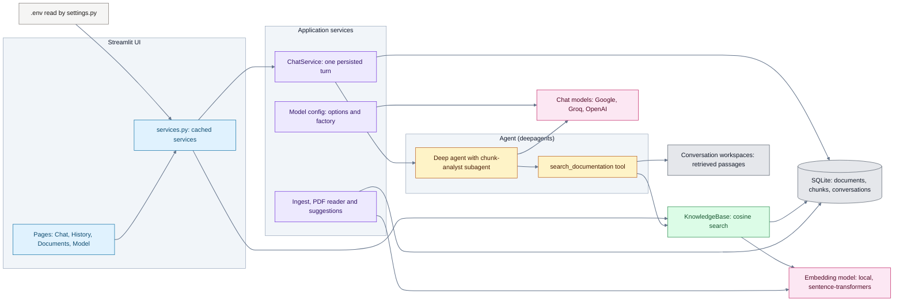
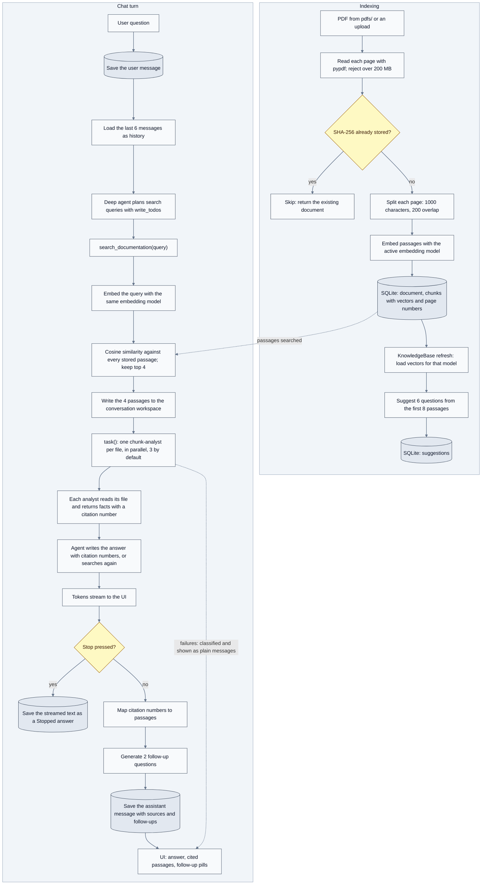

# Lang RAG Assistant


A Streamlit chatbot that answers questions from PDF documents. Every answer cites the passages it came from. Built on LangChain and deepagents, with a local embedding model and SQLite storage.

## Pages

- **Chat**: ask a question and read the answer with its cited passages. Follow-up questions are suggested under each answer. Stop cancels a running answer and keeps what has streamed.
- **History**: search saved conversations and resume one.
- **Documents**: the bundled PDFs and any PDFs you add. Each document has suggested questions.
- **Model**: choose the chat model and the embedding model. Only models whose provider has an API key are listed.

## Project Structure

```
lang-rag-assistant/
├── pyproject.toml                  # Project config, runtime and dev dependencies
├── .env.example                    # Template for environment variables
├── .env                            # Your local keys (gitignored, create from .env.example)
├── .streamlit/config.toml          # Theme, fonts and upload limit
├── pdfs/                           # Bundled PDFs, indexed on first start
├── data/                           # SQLite database and conversation workspaces (created at runtime)
├── logs/                           # Rotating log files (created at runtime)
├── src/lang_rag_assistant/
│   ├── main.py                     # Streamlit entry point and navigation
│   ├── agent.py                    # Deep agent builder, chunk-analyst subagent, step events
│   ├── prompts.py                  # Workflow and subagent instructions
│   ├── tools.py                    # search_documentation tool
│   ├── chat_service.py             # One persisted chat turn, streaming and Stop
│   ├── retrieval.py                # KnowledgeBase: cosine search over stored passages
│   ├── ingest.py                   # PDF indexing, bundled PDFs, re-embedding
│   ├── file_reader.py              # PDF page extraction and size limit
│   ├── suggestions.py              # Suggested questions and follow-ups
│   ├── database.py                 # SQLite repository
│   ├── errors.py                   # Provider error classification and plain messages
│   ├── config/                     # Settings, model options, logging
│   └── ui/                         # Services, components, theme and the four pages
└── tests/                          # Unit and AppTest UI tests
```

## Architecture

### Component diagram

The UI calls application services. The chat service runs the deep agent, which calls the retrieval layer and the chat model. Storage holds the documents, the vectors and the conversations.




### Flow chart

Two paths share the database. Indexing runs at startup and on each upload. A chat turn runs when you send a question.



### Flow summary

1. **Index**: each PDF is read page by page, split into 1000-character passages with 200 characters of overlap, and embedded locally. Identical files are stored once, found by SHA-256.
2. **Ask**: a question is saved, and the last six messages are added as history.
3. **Retrieve**: the agent calls `search_documentation`. The query is embedded, scored by cosine similarity against every stored passage of the active embedding model, and the top four are written to the conversation's workspace.
4. **Analyse**: one chunk-analyst subagent per passage file reads it in parallel, up to `MAX_CONCURRENT_ANALYSTS` at a time.
5. **Answer**: the agent writes the answer with `[n]` citations. Tokens stream to the screen. Stop saves the text streamed so far.
6. **Persist**: the cited passages and two follow-up questions are saved with the message.
7. **Errors**: provider and tool failures are classified (rate limit, quota, rejected key, unavailable, model error). The UI shows a plain message and never the exception text.

## Prerequisites

- Python 3.13+
- [uv](https://docs.astral.sh/uv/) (recommended package manager)
- At least one API key: Google GenAI, Groq or OpenAI

## Setup

```bash
uv sync
cp .env.example .env   # then add at least one API key
```

Edit `.env` and set:

| Variable | Description | Required |
|----------|-------------|----------|
| `LLM_PROVIDER` | Model preselected in the app: `google_genai`, `groq` or `openai` | No (default: `google_genai`) |
| `GOOGLE_MODEL` | Gemini model name | No (default: `gemini-3.1-flash-lite`) |
| `GROQ_MODEL` | Groq model name | No (default: `llama-3.1-8b-instant`) |
| `OPENAI_MODEL` | OpenAI model name | No (default: `gpt-4o-mini`) |
| `GOOGLE_API_KEY` | Google Gemini API key (from https://makersuite.google.com/app/apikey) | At least one key |
| `GROQ_API_KEY` | Groq API key (from https://console.groq.com/keys) | At least one key |
| `OPENAI_API_KEY` | OpenAI API key (from https://platform.openai.com/api-keys) | At least one key |
| `EMBEDDING_MODEL` | `all-MiniLM-L6-v2`, `nomic-embed-text` or `BGE-M3` | No (default: `all-MiniLM-L6-v2`) |
| `MAX_CONCURRENT_ANALYSTS` | Parallel chunk-analyst subagents, 2 to 5 | No (default: `3`) |
| `LOG_LEVEL` | `DEBUG`, `INFO`, `WARNING`, `ERROR` or `CRITICAL` | No (default: `INFO`) |

A model can be chosen in the app only when its key is set. Uploads are limited to 200 MB per PDF.

## Running the App

```bash
uv run streamlit run src/lang_rag_assistant/main.py
```

The first start downloads the embedding model from Hugging Face, then indexes the PDFs in `pdfs/`. Suggested questions need a configured API key. Open the URL that Streamlit prints, usually http://localhost:8501.

## Running Tests

```bash
uv run pytest          # 100 tests
uv run ruff check src tests
uv run ty check src    # type check
```

The test badge reflects the last local run. The repository has no CI workflow yet.

## Configuration

Settings are read from `.env` by `config/settings.py`. Passages are chunked at 1000 characters with 200 characters of overlap. Each search returns the four closest passages.

## License

This project is licensed under the MIT License. See the [LICENSE](LICENSE) file for details.

### Summary

| Aspect | Details |
|--------|---------|
| **License** | MIT License |
| **Copyright** | 2026 Vidhaata Labs (Karthik Prabhu K) |
| **Permissions** | Commercial use, distribution, modification, private use |
| **Limitations** | No warranty, no liability |
| **Conditions** | Include copyright and license notice in copies |

The software is provided "as is", without warranty of any kind. The authors or copyright holders are not liable for any claims, damages, or other liability arising from the use of this software.
