# Lang RAG Assistant: UX flows

Source of truth for the screens: the approved Doop canvas [Lang RAG Assistant](https://doop.design/c/3XoSXpnr0Q), which has pages Overview, Chat, History, Documents, Model and Design system.

Every element in these flows is a native Streamlit component. The Streamlit command for each element is listed in section 11.

Items marked **Open point** are not in the wireframes or were not confirmed. They are collected in section 12 for approval.

---

## 1. Page map

The app has four pages in a sidebar navigation (`st.navigation` with `st.Page`). Chat is the default page.

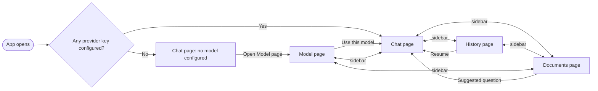

---

## 2. First run and model gating

Doop frames: Chat · No model configured (`EYCJN-8k_B`), Model · Configure (`Ox0gxjGEvs`).

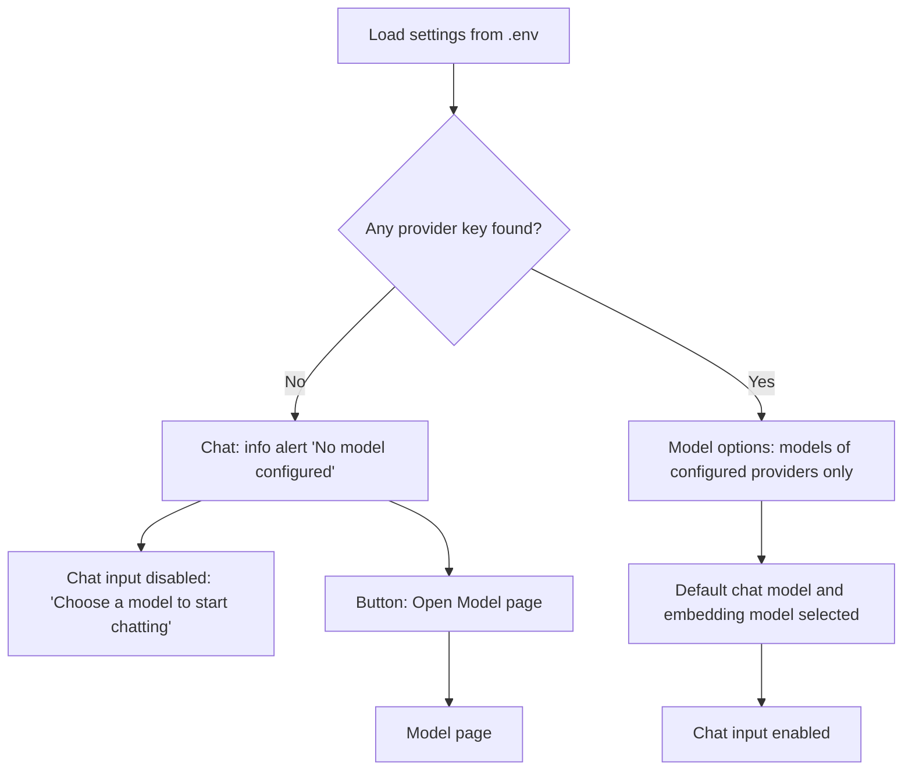

---

## 3. Choose a model (Model page)

Doop frames: Model · Configure (`Ox0gxjGEvs`), Model · Provider without key (`FkOEHsTCFm`).

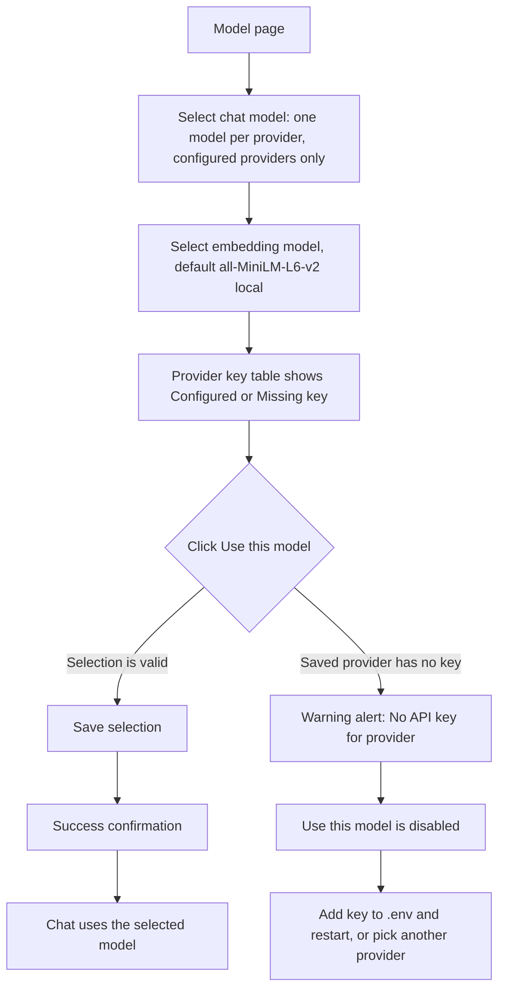

---

## 4. Ask a question and get a cited answer

Doop frames: Chat · Empty state (`rwjJNpYRhs`), Chat · Answer with sources (`h6nBr0rxtv`), Chat · Generating (`_CXI8sszwm`).

Starting points are typing into the chat input or clicking a suggested question. Both go through the same path.

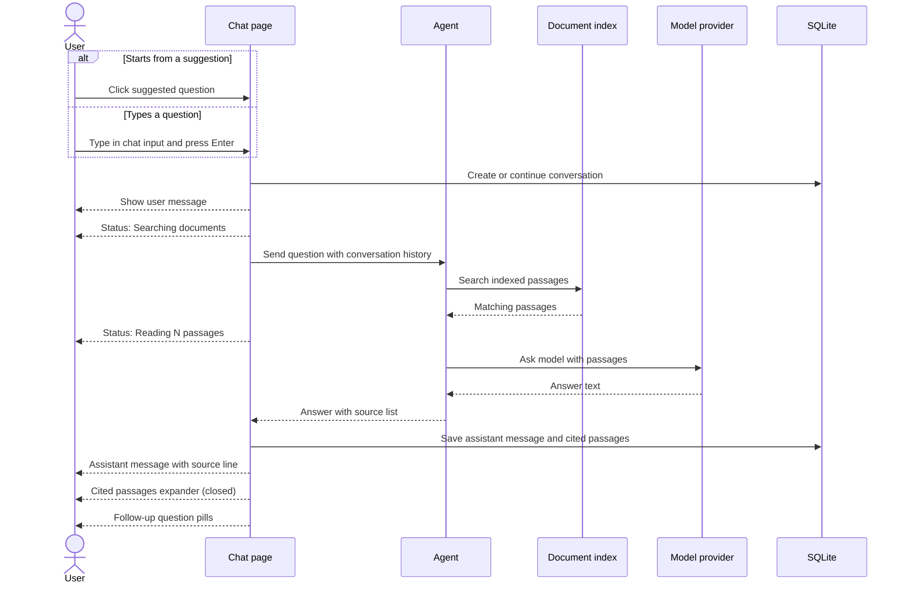

**Follow-up:** a follow-up question uses the same path. The conversation history is sent with it.

**Following a suggestion:** clicking a follow-up pill runs the same path as typing that question.

---

## 5. Stop a running answer

Doop frame: Chat · Generating (`_CXI8sszwm`). The chat input shows a Stop button while an answer is being produced.

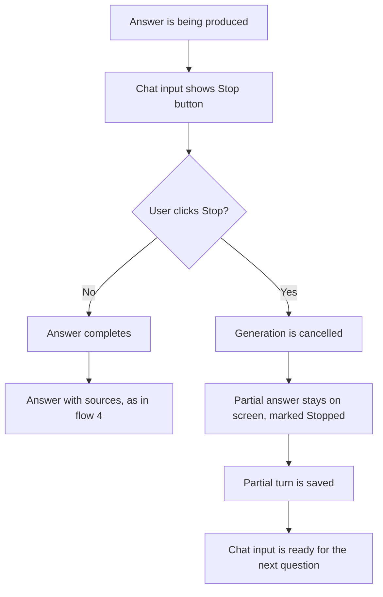

Step G is decided: the core streams answer tokens, so the text streamed so far is saved as the answer and marked Stopped.

---

## 6. Provider error while answering

Doop frame: Chat · Provider error (`10BpD4Db9k`). The question stays visible above the error.

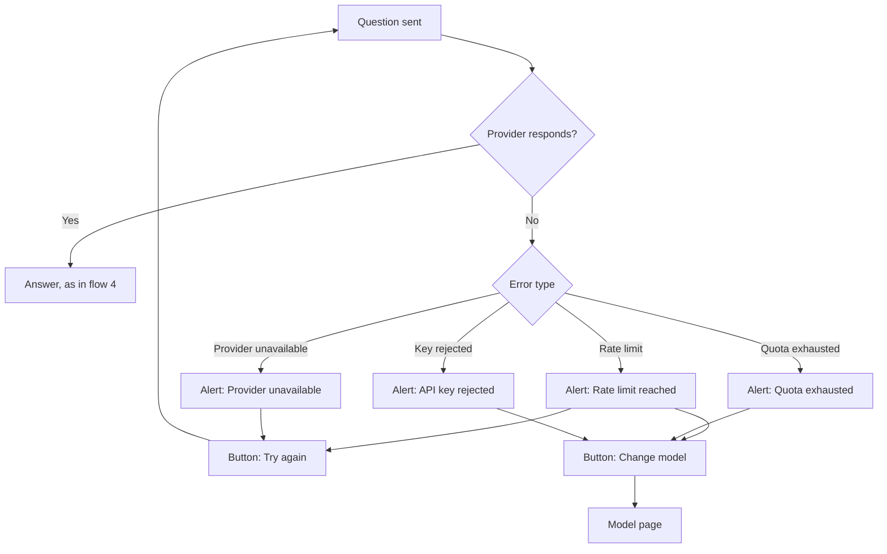

The wireframe shows only the rate-limit alert. Quota, unavailable and key-rejected messages are an **Open point**.

---

## 7. Resume a conversation (History)

Doop frames: History · Saved conversations (`pyrwXMg5_6`), History · Empty (`IUgPU07tjH`).

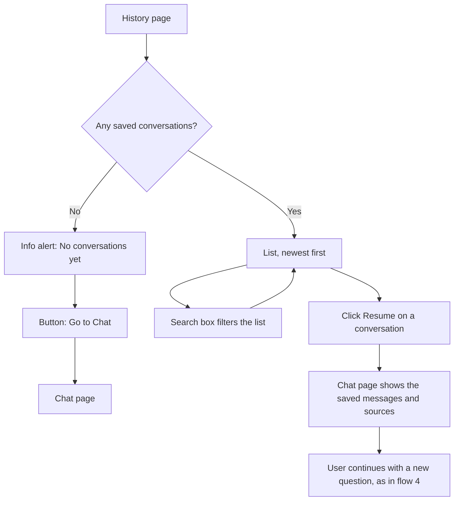

---

## 8. Add a PDF (Documents)

Doop frames: Documents · Library (`2_tdH7XC9j`), Documents · Upload and indexing (`Q5lTDNl-YB`), Documents · Invalid PDF error (`h6UYB94Y-j`).

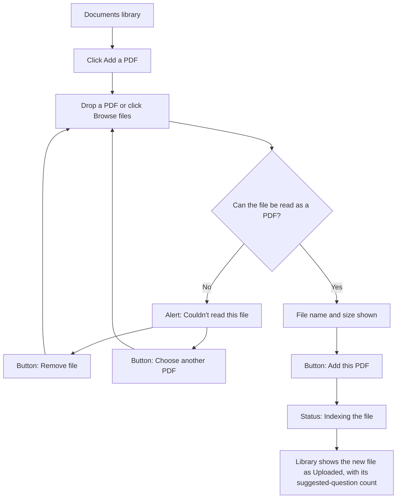

**Note:** the library cards show the file's page count and its number of suggested questions. A new file's suggested questions appear once indexing finishes.

Indexing failure is an **Open point**: the wireframes do not show a failed indexing state.

---

## 9. Suggested questions (Documents to Chat)

Doop frame: Documents · Library (`2_tdH7XC9j`). Each document has a Suggested questions expander, which is collapsed in the wireframes.

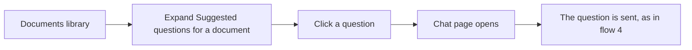

---

## 10. Navigation between pages

Doop frame: Overview · App map (`x6-e9WEWK_`).

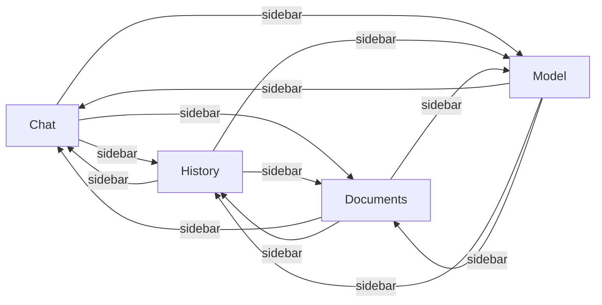

The active page is highlighted in the sidebar with the accent colour (section 14).

---

## 11. Screen inventory

| Page | State | Doop frame | Streamlit elements |
|------|-------|------------|--------------------|
| Chat | Empty state with suggestions | `rwjJNpYRhs` | `st.chat_input`, `st.pills`, `st.caption` |
| Chat | Answer with sources | `h6nBr0rxtv` | `st.chat_message`, `st.status` (compact), `st.expander`, `st.pills` |
| Chat | Generating with Stop | `_CXI8sszwm` | `st.chat_input(submit_mode="stop")`, `st.status` (steps) |
| Chat | Provider error | `10BpD4Db9k` | `st.chat_message`, `st.error(title=...)`, `st.button` ×2 |
| Chat | No model configured | `EYCJN-8k_B` | `st.info(title=...)`, `st.button`, `st.chat_input` (disabled), `st.sidebar.selectbox` (disabled) |
| History | Saved conversations | `pyrwXMg5_6` | `st.text_input`, `st.container(border=True)`, `st.button` (Resume) |
| History | Empty | `IUgPU07tjH` | `st.info(title=...)`, `st.button` |
| Documents | Library | `2_tdH7XC9j` | `st.button` (Add a PDF), `st.container(border=True)`, `st.badge`, `st.expander` |
| Documents | Upload and indexing | `Q5lTDNl-YB` | `st.file_uploader`, `st.button`, `st.status`, `st.progress` |
| Documents | Invalid PDF | `h6UYB94Y-j` | `st.file_uploader`, `st.error(title=...)`, `st.button` |
| Model | Configure | `Ox0gxjGEvs` | `st.selectbox` ×2, `st.button` (Use this model), `st.table` or `st.dataframe` for keys |
| Model | Provider without key | `FkOEHsTCFm` | `st.selectbox`, `st.warning(title=...)`, `st.button` (disabled) |

---

## 12. Open points

These need your approval before implementation. My recommendation is in each entry.

1. **Decided: the model picker lists only models whose provider has a configured key.** There is one model per provider, so the chat model picker is the only chooser and there is no separate provider picker. The "provider without key" frame covers only the case where a saved model loses its key.
2. **Decided: Inter for body and headings, JetBrains Mono for code.** Set in `.streamlit/config.toml` with Streamlit's Google Fonts URL syntax, so the app renders the same faces as the wireframes:

   ```toml
   font = "Inter:https://fonts.googleapis.com/css2?family=Inter:wght@400;500;600;700&display=swap"
   headingFont = "Inter:https://fonts.googleapis.com/css2?family=Inter:wght@400;500;600;700&display=swap"
   codeFont = "'JetBrains Mono':https://fonts.googleapis.com/css2?family=JetBrains+Mono:wght@400;500&display=swap"
   ```

3. **Stop keeps the partial answer,** marks it Stopped, and saves it. Recommended. The wireframes do not show the marker.
4. **Quota, unavailable and key-rejected messages** use the same alert pattern as rate limit, with the copy written during implementation. Recommended.
5. **Changing the embedding model** would need documents to be re-indexed. Not in the wireframes. Proposal: warn the user and re-index on confirm.
6. **Model selection is saved** to the local database, so it survives a restart. Not in the wireframes. Proposal: save it.
7. **History search** matches conversation titles only. Not in the wireframes. Proposal: titles only.
8. **Indexing failure** shows an error alert, and the file is not added to the library. Not in the wireframes. Proposal: add it, using the Invalid PDF pattern.
9. **Regenerate suggestions** was in the earlier app but is not in the wireframes, so it is excluded. Add it if wanted.

---

## 13. Start a new chat (added after approval)

Added at your request. The Chat sidebar has a "New chat" button, below the model picker. It leaves the current conversation, so the next question starts a new one and the empty state with its suggested questions returns. Saved conversations stay in History.

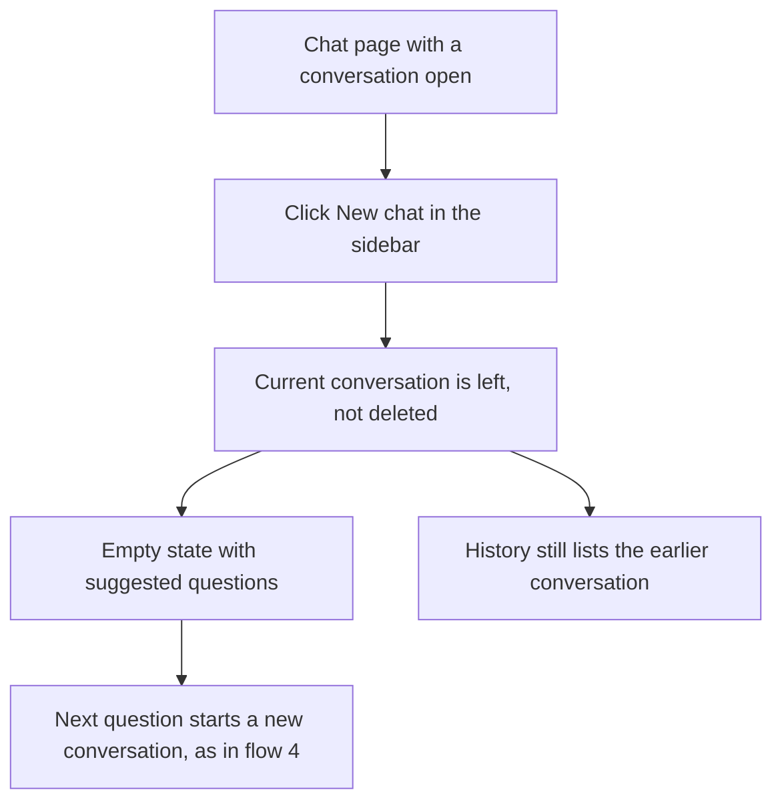

Decided after the review: Stop saves the partial answer marked Stopped (the core streams tokens); document cards show pages and six suggested questions, as in the wireframes; the upload limit is 200 MB, as in the wireframes.

---

## 14. Sidebar brand, navigation and footer (added after the build)

Added after the build, so the Doop frames do not show it yet. Every page uses the same sidebar, top to bottom:

1. **Brand row.** The app icon with the title "Lang RAG Assistant" beside it, as one image above the menu. Title in Inter Bold, 16px, colour `#1F1B16`, 10px gap from a 32px icon with 8px corner radius. The browser tab shows the icon alone.
2. **Menu.** Chat, History, Documents, Model. The active item uses the accent colour `#B45309`, semibold. No collapse or expand toggle, because the wireframes show none and the sidebar stays open.
3. **Chat only:** the chat model picker and the New chat button (section 13).
4. **Footer.** "Powered by Vidhaata Labs", 13px Inter in the muted token `#6B6158`, pinned to the bottom-left of the sidebar on every page. The Doop frames carry it as the last item in each sidebar (12 screen frames). The wireframes gave no footer spec, so these values were chosen during the build.

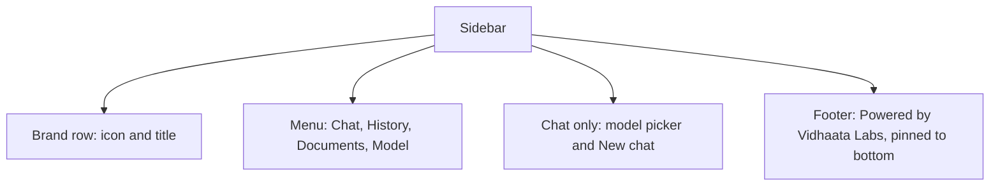

Decided: the brand row sits above the menu, not below it. Streamlit's native logo cannot hold text, so the title is drawn into the logo image and its font is approximated from Inter Bold, so the rendering may differ slightly from the wireframe type.
